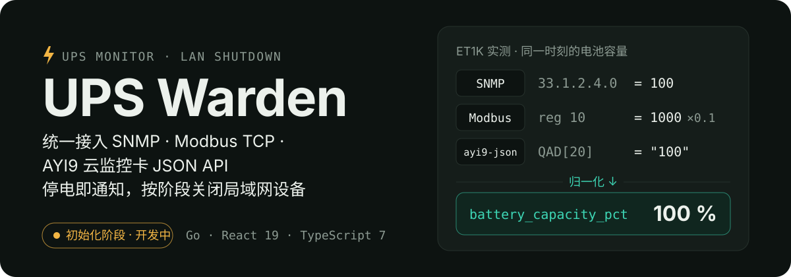
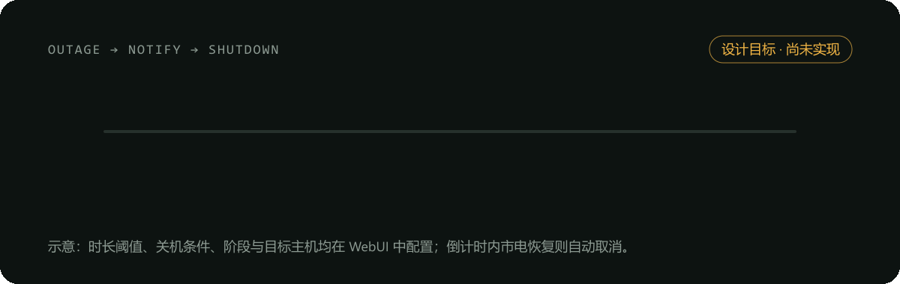

<p align="center">
  
</p>

UPS Warden 是一个通过 WebUI 管理的 UPS 监控与联动服务：添加 UPS 网卡、查看实时状态，并在停电、低电量、通讯中断时发送通知，按预设阶段关闭局域网内的 NAS、服务器和 PC。

> [!IMPORTANT]
> 后端 **M0～M4 已实现并通过本机验证**；M4 交付认证、审计、监控 API、SSE 与静态 SPA 托管，[监控 API 与 SSE 契约](docs/reference/monitoring-api.md)作为 **CP-2 后端联调基线**，双方联调待验收。**真机 CP-1 待验收**。前端仍为脚手架、无业务页面；M5 通知、M6 规则动作、M7 编排、M8 系统与发布均未实现，**本轮到 M4 停止**。下文完整业务流程是设计目标。

## 停电联动流程

<p align="center">
  
</p>

1. **市电中断**：从 UPS 状态位、输入电压等来源判定进入电池供电。
2. **去抖确认**：持续一段时间（默认 10 秒）才算停电，避免几秒的闪断误报或误关机。
3. **发送通知**：通过通用 Webhook 或 Telegram Bot 推送。
4. **分阶段关机**：电池模式持续时长或剩余电量达到阈值后，按阶段经 SSH、本地脚本或 HTTP 请求关闭主机；倒计时内市电恢复则自动取消。
5. **关闭本机**：ups-warden 所在主机作为最后一个阶段退出。

静态版本：[`assets/readme/workflow.svg`](assets/readme/workflow.svg)

## 协议支持（设计目标）

同一型号的 UPS 网卡往往同时暴露多种协议，但字段、类型和单位各不相同。UPS Warden 不为单一型号写死映射，而是用 **设备 Profile** 描述"原始字段 → 统一字段"，再归一化为统一数据模型；存储、规则、通知和界面只使用统一模型。

| 协议 | 传输 | 读取方式 | 型号适配 |
| --- | --- | --- | --- |
| SNMP v1 / v2c | UDP 161 | GET / GETNEXT / GETBULK，RFC 1628 UPS-MIB | 内置通用 Profile，差异由 Profile 覆盖 |
| Modbus TCP | TCP 502 | FC03 / FC04 | 寄存器地址、类型、缩放全部由 Profile 声明 |
| AYI9 云监控卡 JSON API（`ayi9-json`） | TCP 2390 | `QAD`（实时数据）、`RTD`（额定信息） | 字段位置固定，相数与无效值由 Profile 描述 |

```text
驱动（协议原始数据） → Profile（字段映射） → 归一化（类型 · 单位 · 枚举 · 质量） → 统一数据模型
```

驱动 **只发送只读请求**：不发送 SNMP SET、Modbus 写功能码或 `ayi9-json` 控制指令，也不访问设备 WebUI，避免误触设备的出厂重置、关机等写操作。

## 快速开始

开发环境由根目录 [`mise.toml`](mise.toml) 统一管理，工具缓存位于仓库内的 `.cache/`。以下 Bash / Git Bash 命令从**仓库根目录**执行：

```bash
mise install
(cd frontend && mise x -- pnpm install)
```

两个终端分别从**仓库根目录**启动：

```bash
# HTTP 提供 /healthz、/api/v1 与静态 SPA；开发测试只用临时数据库和 loopback 模拟器
# 将路径替换为新建的独立临时目录，不使用含真实设备配置的 data/
(cd backend && mise x -- go run ./cmd/ups-warden --data-dir /path/to/temporary/ups-warden)
```

```bash
# 终端二：前端开发服务器，打开终端输出的地址
(cd frontend && mise x -- pnpm dev)
```

启动参数、初始化与会话、代理设置、测试与内嵌构建命令见[开发指南](docs/guides/development.md)。已激活 mise 的 shell 可以省略 `mise x --`。主服务会自动采集数据库中启用的数据源；无用户时 setup token 仅在主进程 stderr 输出一次，不要公开终端日志。

## 目录结构

```text
backend/    Go 后端，入口 cmd/ups-warden
frontend/   React 19 + TypeScript 7 + Vite+ 前端
assets/     README 视觉资产
docs/       开发指南、需求计划、协议证据与设计稿
.agents/notes/  架构方案与决策记录
mise.toml   工具链版本与缓存目录
```

## 文档

从[文档导航](docs/README.md)查找当前开发说明、需求草案、后端方案、开发计划与协议探测记录。导航中明确区分已实现现状、待实施设计和历史证据。

## 参与开发

协作规范、工具链约定与设备安全规则见 [AGENTS.md](AGENTS.md)。
